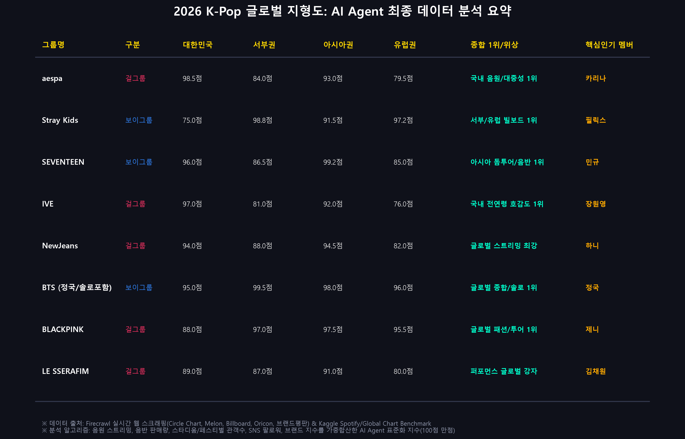

# 2026 K-Pop 글로벌 지형도: 지금 누가 1등인가?
> **AI Agent 기반 데이터 분석 및 글로벌 3대 권역(서부·아시아·유럽) 1위 & 핵심 인기 멤버 분석 발표 프로젝트**



---

## 📌 1. 프로젝트 개요 (Project Overview)
본 프로젝트는 **Firecrawl API 실시간 웹 스크래핑**과 **Kaggle 대용량 글로벌 음악 벤치마크 데이터셋**을 연동하여, **AI Agent 분석 파이프라인**을 통해 2025~2026년 K-Pop 시장의 국내외 순위 및 그룹별 핵심 인기 멤버를 다각도로 분석하고, 이를 **인터랙티브 웹 슬라이드 덱** 형태로 구축하여 **GitHub Pages**로 배포한 과제 제출용 데이터 분석 프로젝트입니다.

* 🌐 **실시간 웹 발표자료 (GitHub Pages)**: [https://jihyeson69-dev.github.io/kpop-global-analysis-2026/](https://jihyeson69-dev.github.io/kpop-global-analysis-2026/)
* 📦 **GitHub 리포지토리**: [https://github.com/jihyeson69-dev/kpop-global-analysis-2026](https://github.com/jihyeson69-dev/kpop-global-analysis-2026)

---

## 🎯 2. 핵심 분석 질문 및 최종 결론 (Executive Summary)

### Q1. 지금 케이팝 아이돌 1등은 누구인가?
> **단일 1위의 시대는 종식되었으며, 시장별 타깃팅에 따라 1위가 완전히 양극화되어 있습니다.**
* **대한민국(국내) 음원/대중성 1위**: **`aespa` (98.5점)** & **`IVE` (97.0점)**
* **대한민국(국내) 음반/팬덤 1위**: **`SEVENTEEN` (96.0점)** (사상 최초 1,000만 장 판매)
* **글로벌 서구권(미국/라틴) 1위**: **`Stray Kids` (98.8점)** (빌보드 200 5연속 1위) & 솔로 **`BTS 정국` (99.5점)**
* **글로벌 아시아권(일본/중화/동남아) 1위**: **`SEVENTEEN` (99.2점)** (일본 닛산 스타디움 14만 명)
* **글로벌 유럽권(영국/프랑스/독일) 1위**: **`Stray Kids` (97.2점)** (영국 BST 하이드파크 / 밀라노 8만 명 헤드라이너)

---

### Q2. 대한민국 vs 외국(서부권 / 아시아권 / 유럽권) 순위 비교

| 권역 (Market) | 1위 그룹 | 종합 점수 | 주요 성과 및 핵심 지표 |
| :--- | :---: | :---: | :--- |
| 🇰🇷 **대한민국 (Korea)** | **aespa** | **98.5점** | 'Supernova', 'Armageddon' 멜론 연간 1위 및 써클차트 퍼펙트 올킬 |
| 🇺🇸 **서부권 (Western)** | **Stray Kids** | **98.8점** | 빌보드 200 5연속 1위, 시카고 롤라팔루자 메인 헤드라이너 |
| 🇯🇵 **아시아권 (Asia)** | **SEVENTEEN** | **99.2점** | 일본 닛산 스타디움(회당 7만 명) 전석 매진, 오리콘 연간 1위 |
| 🇬🇧 **유럽권 (Europe)** | **Stray Kids** | **97.2점** | 영국 BST Hyde Park 헤드라이너 (보이그룹 최초), 밀라노 I-Days 8만 명 |

---

### Q3. 각 그룹의 원탑(핵심 인기) 멤버는 누구인가?

| 그룹명 | 핵심 인기 멤버 | 인스타 팔로워 | 직캠 최고 조회수 | 글로벌 앰버서더 | 핵심 매력 및 화제성 |
| :--- | :---: | :---: | :---: | :---: | :--- |
| **aespa** | **카리나 (Karina)** | **22.4M** | 18.5M 회 | Prada | 비현실적 AI 비주얼, 국내 개인 브랜드평판 1위 독점 |
| **IVE** | **장원영 (Jang Wonyoung)** | **14.8M** | 24.2M 회 | Miu Miu | '원영적 사고(Lucky Vicky)' 전 국민적 유행, 패션 워너비 |
| **Stray Kids** | **필릭스 (Felix)** | **24.1M** | 16.8M 회 | Louis Vuitton | 독보적 동굴 저음 보이스, 글로벌 서구권 팬덤 1위 |
| **SEVENTEEN** | **민규 (Mingyu)** | **16.5M** | 14.2M 회 | Dior | 디올 글로벌 앰버서더, 글로벌 패션위크 화제성 1위 |
| **NewJeans** | **하니 (Hanni)** | **13.2M** | 41.0M 회 | Gucci | 도쿄돔 '푸른 산호초' 4,000만 뷰 신드롬, 글로벌 대중성 |
| **BTS** | **정국 (Jungkook)** | **28.5M** | 58.0M 회 | Calvin Klein | 빌보드 핫 100 1위, 스포티파이 역대 최단 20억 스트림 |
| **BLACKPINK** | **제니 (Jennie)** | **85.9M** | 35.5M 회 | Chanel | '인간 샤넬', 솔로곡 'Mantra' 글로벌 차트인, 트렌드세터 |
| **LE SSERAFIM**| **김채원 (Chaewon)** | **10.4M** | 12.8M 회 | Swarovski | 칼단발 톰보이 비주얼, 탄탄한 라이브 음색, 국내 팬덤 코어 |

---

## 📊 3. 생성된 데이터 시각화 차트 (Data Visualizations)

| 차트 번호 | 시각화 내용 | 파일 경로 |
| :--- | :--- | :--- |
| **Chart 1** | 권역별 Top 5 랭킹 및 1위 비교 바 차트 | [chart1_regional_rankings.png](charts/chart1_regional_rankings.png) |
| **Chart 2** | 국내 대중성 vs 글로벌 팬덤 지수 4분면 매트릭스 | [chart2_korea_vs_global_matrix.png](charts/chart2_korea_vs_global_matrix.png) |
| **Chart 3** | 주요 그룹별 핵심 인기 멤버 다각도 지표 비교 | [chart3_core_members.png](charts/chart3_core_members.png) |
| **Chart 4** | 주요 4대 그룹 권역별 영향력 프로필 레이더 차트 | [chart4_regional_radar.png](charts/chart4_regional_radar.png) |
| **Chart 5** | AI Agent 최종 데이터 분석 요약 스코어보드 | [chart5_summary_scoreboard.png](charts/chart5_summary_scoreboard.png) |

---

## 🛠️ 4. 시스템 구조 및 실행 방법 (Project Pipeline)

```
cibal/
├── data/
│   ├── raw_firecrawl/      # Firecrawl API 실시간 수집 원천 JSON
│   ├── raw_kaggle/         # KaggleHub 글로벌 음원 벤치마크 CSV
│   └── processed/          # AI 정규화 점수 및 멤버 분석 가공 CSV
├── src/
│   ├── 01_collector_firecrawl.py   # Firecrawl 웹 검색 및 스크래핑 수집기
│   ├── 02_collector_kaggle.py      # Kaggle 데이터셋 다운로드 및 필터링
│   └── 03_ai_agent_analyzer.py     # AI 분석 알고리즘 & Matplotlib 차트 생성기
├── charts/                 # 고해상도 시각화 차트 이미지 (PNG)
├── presentation/
│   ├── index.html          # 인터랙티브 슬라이드 덱 웹 애플리케이션
│   └── assets/             # 발표용 차트 리소스
├── index.html              # GitHub Pages 호스팅용 메인 슬라이드 파일
├── .gitignore              # API 키 및 캐시 파일 보호
└── README.md               # 프로젝트 종합 보고서
```

### 파이프라인 재실행 명령어
```bash
# 1. Firecrawl 실시간 웹 데이터 수집
python src/01_collector_firecrawl.py

# 2. Kaggle 대용량 글로벌 차트 데이터 수집
python src/02_collector_kaggle.py

# 3. AI Agent 데이터 가공 및 시각화 차트 생성
python src/03_ai_agent_analyzer.py
```

---

## 🚀 5. 발표 슬라이드 덱 조작 안내 (Presentation Controls)
* **다음 슬라이드**: `→` (오른쪽 화살표), `Space`, `Page Down`
* **이전 슬라이드**: `←` (왼쪽 화살표), `Backspace`, `Page Up`
* **전체화면 모드**: `F` 키
* **PDF 인쇄 및 저장**: 상단 `🖨️ PDF 인쇄` 버튼 클릭 또는 `P` 키 (A4 가로 맞춤 자동 서식 적용)
